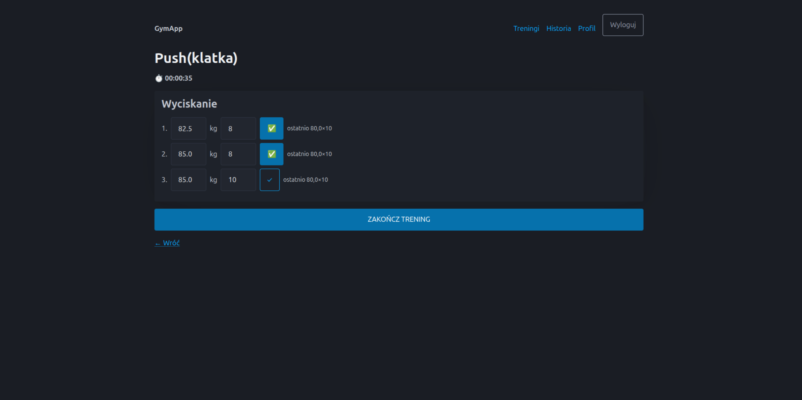
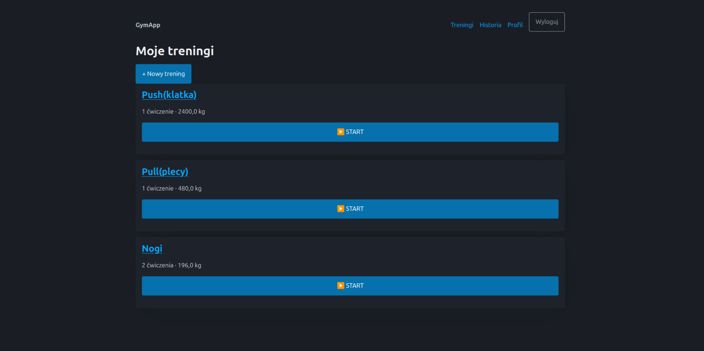
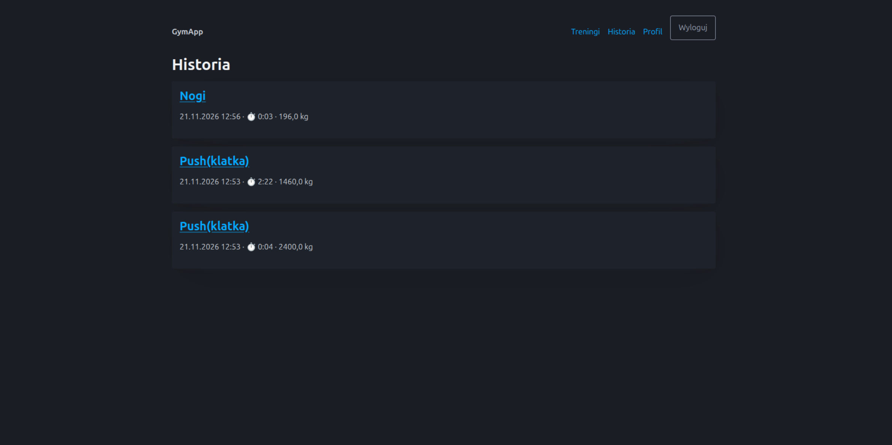

# GymApp

Web app for planning and logging gym workouts – built from scratch with Django.



## Features
- Create workout plans (exercises, sets, reps, weight, rest, RIR)
- Live workout session with timer – log actual weight/reps per set
- "Last time" hint for every set to track progressive overload
- Workout history with duration and total volume
- User accounts – each user sees only their own data

## Run locally
```bash
git clone https://github.com/lucc1to/gymapp.git
cd gymapp
python3 -m venv .venv && source .venv/bin/activate
pip install -r requirements.txt
cp .env.example .env
python manage.py migrate
python manage.py seed_exercises
python manage.py createsuperuser
python manage.py runserver
```

## Screenshots
| Workouts | Session | History |
|---|---|---|
|  |  |  |